<table>
  <tr>
    <td valign="middle" align="left">
      <h1>Shaik Zeeshaan Suhail</h1>
      

        Computer science student in India passionate about software engineering, cybersecurity, and artificial intelligence. I build full-stack applications, primarily using Python, Django, and React, with an interest in backend architecture, application security, and building reliable systems.
      

      

I've built projects like CrawlSync, a web crawling project, and esign-platform, an e-signature application. Alongside software development, I'm exploring machine learning and large language models, learning concepts like tokenization, model architectures, and AI-powered applications through hands-on experimentation.
      

      

        
        
      

    </td>
    <td valign="middle" align="center">
      
       
      My koi. Redrawn every night from my public GitHub activity.
    </td>
  </tr>
</table>

  

 

  

 

---

## Things I've built

| Project                  | Description                                                                                                      |
| ------------------------ | ---------------------------------------------------------------------------------------------------------------- |
| [CrawlSync](https://github.com/Zeeshaan-23/CrawlSync) | Web crawler project.                                                                                       |
| [esign-platform](https://github.com/Zeeshaan-23/esign-platform) | E-signature application featuring JWT authentication, Celery-backed workflows, PDF generation and audit trails. |
| [UniMeet](https://github.com/Zeeshaan-23/UniMeet) | Campus collaboration and event management platform.                                                              |
| [DBMS-Hospital-Management](https://github.com/Zeeshaan-23/DBMS-Hospital-Management) | Relational database design for hospital operations. |

---

## What I work with

## Technical Skills

- **Languages:** Python, Go, JavaScript, TypeScript, Java, SQL, C
- **Backend & Full Stack:** Django, Django REST Framework, Node.js, Express.js, React, Vite
- **Databases & Infrastructure:** PostgreSQL, MongoDB, Redis, MySQL, Docker
- **Cybersecurity:** Authentication, JWT, Session Management, Content Security Policy (CSP), Rate Limiting, Secure Application Development
- **Machine Learning:** Regression, Classification, Clustering, Decision Trees, Feature Selection, ML Fundamentals
- **LLMs & AI:** Tokenization, LLM Fundamentals, Transformer Architecture, AI-powered Applications
- **Developer Tools:** Git, GitHub, Postman

---

## Activity

---

  Questions, ideas or an internship that fits? <a href="mailto:zeeshaansuhail23@gmail.com">Email me</a>.

